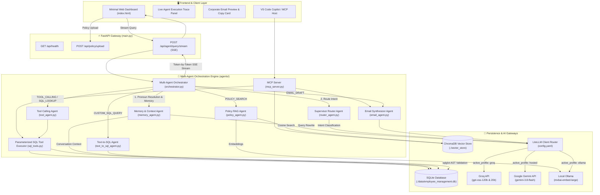
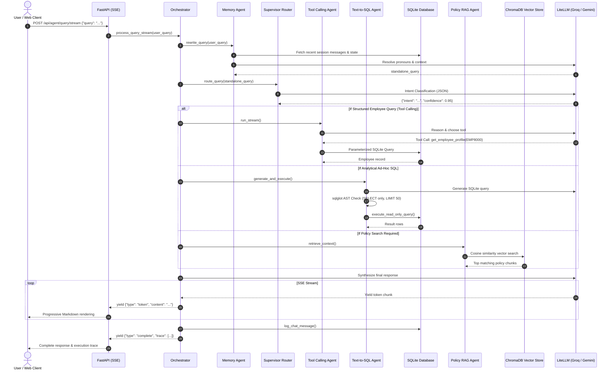
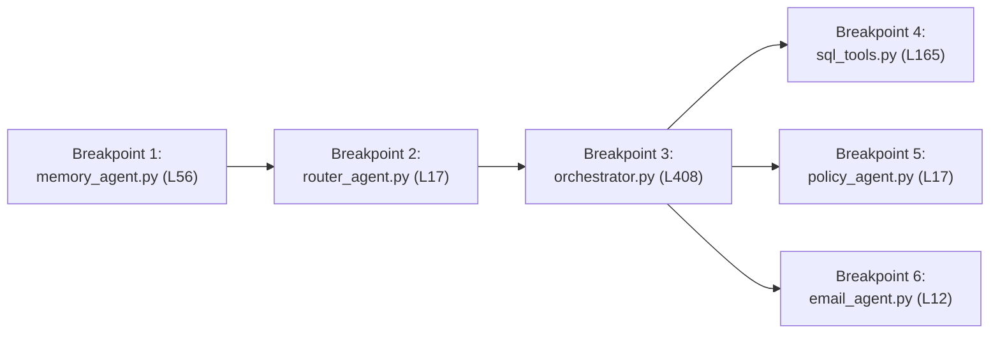

# 🏗️ Technical Solution Architecture: Enterprise Employee RAG & Multi-Agent System

## 1. Executive Overview

The **Enterprise Employee RAG & Multi-Agent System** is a production-grade artificial intelligence solution designed to combine **structured enterprise relational data (SQLite)** with **unstructured knowledge retrieval (ChromaDB Vector RAG)** and **automated business action execution (Email Generation)**.

The architecture prioritizes zero-dependency portability and high performance:
- Relational data is managed via an embedded **SQLite** engine, auto-seeded with 28 realistic enterprise employees across 8 departments, 5 office locations, multi-tier management reporting, and 7 leave types.
- Policy knowledge is indexed into an embedded **ChromaDB** vector store using semantic embeddings (`mxbai-embed-large`).
- LLM inference is managed through **LiteLLM**, enabling effortless switching between cloud providers (**Groq** for ultra-fast response times, **Google AI Studio Gemini**) and offline local execution (**Ollama**).
- The solution is containerized via **Docker & Docker Compose** with persistent host volumes for data and vector storage.
- The web interface is engineered as a **minimalist, clean enterprise SPA** with real-time SSE streaming and a live execution trace visualizer.

---

## 2. Technical Stack & Infrastructure

| Subsystem | Technology | Purpose & Role |
| :--- | :--- | :--- |
| **Backend API** | **Python 3.10+ / FastAPI** | Asynchronous REST endpoints, static UI serving, Server-Sent Events (SSE) streaming |
| **Relational Database** | **SQLite (`sqlite3`)** | Self-contained relational store (`./data/employee_management.db`) with auto-seeding & safe schema view |
| **Vector Database** | **ChromaDB (Persistent)** | Embedded vector store (`./vector_store`) indexing the 10-section Corporate Policy manual (42 chunks) |
| **LLM Gateway** | **LiteLLM (`config.yaml`)** | Unified model client supporting selectable profiles (`groq`, `hosted`, `ollama`) with structured JSON parsing |
| **Cloud LLM (Primary)** | **Groq API** | High-throughput inference (`openai/gpt-oss-120b` for reasoning, `openai/gpt-oss-20b` for routing) |
| **Cloud LLM (Alternative)** | **Google Gemini** | Hosted profile using `gemini-3.8-flash` / `gemini-3.5-flash-lite` |
| **Local AI Services** | **Ollama** | Local profile running `llama3.1`, `qwen2.5:1.5b`, and `mxbai-embed-large` embeddings |
| **Containerization** | **Docker & Docker Compose** | Portable microservice packaging with volume mounts for database and vector store |
| **Frontend UI** | **HTML5 / Vanilla CSS / JS** | Minimalist SaaS aesthetic (slate/zinc palette), Suggested query chips, SSE streaming, and Execution Trace Timeline |
| **Agent Protocol** | **Model Context Protocol (MCP)** | Stdio-based server (`mcp_server.py`) for VS Code Copilot and Claude Desktop tool invocation |

---

## 3. High-Level System Architecture Diagram

---

## 4. Subsystem & Component Details

### 4.1. Relational Database Layer (`database.py`)
Connects to an embedded SQLite database (`./data/employee_management.db`) using Python's standard `sqlite3` library.
- **Enterprise Schema:**
  - `Departments`: 8 business units (Executive, Engineering, Product, HR, Finance, Marketing, Customer Success, Sales).
  - `Designations`: 24 corporate roles from C-suite to senior specialists.
  - `Locations`: 5 office centers (Bengaluru HQ, Hyderabad, Mumbai, Pune, Remote/Hybrid).
  - `LeaveTypes`: 7 categories (`CL`, `EL`, `SL`, `ML`, `PL`, `BL`, `TL`).
  - `Employees`: 28 full employee profiles with manager hierarchies, corporate emails, hire dates, and salary figures.
  - `EmployeeLeaveBalances`: Available and used balances per employee.
  - `ChatSessions` & `ChatMessages`: Multi-turn conversational persistence.
- **Auto-Initialization & Seeding:** On startup, automatically creates tables and seeds full enterprise records if employee count is below threshold.
- **Safe Schema Introspection:** Exposes database schema via `PRAGMA table_info` while redacting sensitive columns like `Salary` for ad-hoc Text-to-SQL generation.

### 4.2. Vector Storage & Ingestion (`vector_db.py`)
Indexes company policies into an embedded persistent ChromaDB collection.
- **Document Chunking:** Recursive paragraph and sentence chunking (`chunk_size=500`, `chunk_overlap=50`).
- **Embeddings:** Generates vector representations via Ollama's `mxbai-embed-large` (1024 dimensions) with resilient timeout and fast fallback handling.
- **Policy Ingestion:** Automatically ingests the 10-section [`sample_policy.md`](./sample_policy.md) (42 chunks).

### 4.3. Multi-Agent Engine (`agents/`)
- **`memory_agent.py`:** Analyzes recent chat turns to resolve pronouns ("his manager", "her leave balance", "write an email to her") to active entity IDs (e.g. `EMP8000`) before routing, avoiding redundant clarification loops. Enforces ~1000 token budgeting on history context.
- **`router_agent.py`:** Employs the `fast-llm` model to classify incoming queries into six functional intents with strict JSON schemas:
  1. `COMPANY_STATS_QUERY`: Company-wide employee counts and department metrics.
  2. `EMAIL_ACTION`: Drafting formal corporate emails.
  3. `HYBRID_POLICY_EMPLOYEE`: Questions combining company policy rules with individual employee balances.
  4. `EMPLOYEE_SQL_QUERY`: Queries asking for a specific employee's profile or leave balances.
  5. `CUSTOM_SQL_QUERY`: Ad-hoc or complex database queries.
  6. `POLICY_QUERY`: General policy, benefits, and HR guidelines.
- **`tool_agent.py` & `sql_tools.py`:** Autonomous agent loop using function calling against safe, parameterized SQL primitives (`get_employee_profile`, `get_leave_balance`, `get_team_members`, `get_department_stats`).
- **`text_to_sql_agent.py`:** Generates arbitrary SQLite analytical queries guarded by `sqlglot` (enforcing `SELECT`-only statements, banning mutation keywords, and enforcing `LIMIT 50`).
- **`email_agent.py`:** Synthesizes professional corporate communications with recipient validation and manager CC lookups.
- **`orchestrator.py`:** State machine coordinating agent transitions and yielding real-time execution traces for frontend observability.

### 4.4. Model Context Protocol (MCP) Server (`mcp_server.py`)
Exposes the multi-agent tools over standard I/O (stdio) compliant with the open Model Context Protocol. Compatible with VS Code GitHub Copilot, Cursor, and Claude Desktop.

---

## 5. End-to-End Sequence Diagram

---

## 6. Interactive Debugging Architecture

The system supports granular step debugging across all agent execution stages via standard IDE debuggers:

Developers can attach the Python debugger (`F5`) to inspect runtime variables (`session_id`, `emp_data`, `retrieved_chunks`, `tool_calls_made`) and step through decisions before responses stream to the client.

---

## 7. Security, Privacy & Safety Guardrails

1. **Local Data Sovereignty:** Relational data (`./data/employee_management.db`) and vector indices (`./vector_store/`) are stored locally on disk and never uploaded to external databases.
2. **Read-Only AST Validation:** All Text-to-SQL outputs pass through `sqlglot` AST parsing. Statements containing `INSERT`, `UPDATE`, `DELETE`, `DROP`, `ALTER`, or `ATTACH` are blocked before reaching SQLite.
3. **Sensitive Field Protection:** Ad-hoc SQL schemas redact sensitive financial columns like `Salary` by default.
4. **Parameterized Primitives:** Standard profile lookups and leave calculations use bound parameters (`?`), preventing SQL injection.
5. **Row Retrieval Caps:** Ad-hoc queries automatically enforce `LIMIT 50` to mitigate denial-of-service and memory exhaustion.
6. **Credential Hygiene:** Cloud LLM API keys (`GROQ_API_KEY`, `GEMINI_API_KEY`) reside exclusively in git-ignored `config.local.yaml`.
