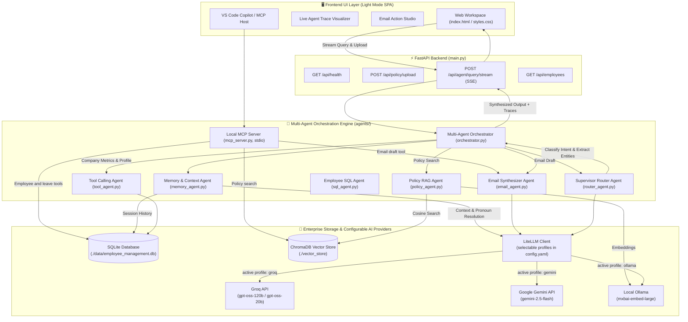
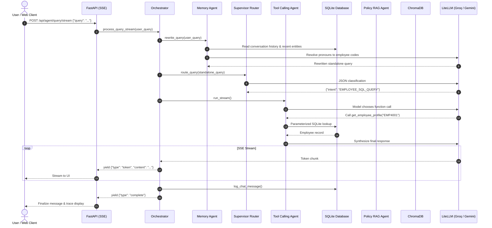

# 🏗️ Technical Architecture Report: Enterprise Employee RAG & Multi-Agent System

> [!NOTE]
> This document details the technical architecture, data flows, multi-agent orchestration, and component interactions of the **Enterprise Employee RAG System** powered by **SQLite**, **ChromaDB**, and **LiteLLM** (supporting Groq, Google Gemini, and local Ollama), fully deployable locally or via **Docker**.

---

## 1. High-Level Architecture Diagram

---

## 2. Component Breakdown

| Subsystem | File Reference | Primary Function |
| :--- | :--- | :--- |
| **FastAPI Web Server** | [`main.py`](file:///c:/D/Playground/Gen%20AI/EmployeeManagementRAGSystem/main.py) | REST API endpoints (`/api/agent/query/stream`, `/api/policy/upload`, `/api/health`, `/api/employees`) and static SPA hosting. |
| **Relational Database** | [`database.py`](file:///c:/D/Playground/Gen%20AI/EmployeeManagementRAGSystem/database.py) | Self-contained SQLite database (`./data/employee_management.db`), auto-seeded with 28 employees, 8 departments, 24 designations, 7 leave types, and safe schema projection. |
| **Vector DB Store** | [`vector_db.py`](file:///c:/D/Playground/Gen%20AI/EmployeeManagementRAGSystem/vector_db.py) | ChromaDB persistent store indexing the 10-section Corporate Policy manual with local embedding generation and fallback handling. |
| **LLM Gateway** | [`litellm_client.py`](file:///c:/D/Playground/Gen%20AI/EmployeeManagementRAGSystem/litellm_client.py), [`config.yaml`](file:///c:/D/Playground/Gen%20AI/EmployeeManagementRAGSystem/config.yaml) | Unified interface supporting Groq (`openai/gpt-oss-120b`, `openai/gpt-oss-20b`), Google Gemini (`gemini-2.5-flash`), and local Ollama (`llama3.1`). |
| **Memory Agent** | [`agents/memory_agent.py`](file:///c:/D/Playground/Gen%20AI/EmployeeManagementRAGSystem/agents/memory_agent.py) | Context-aware pronoun and entity resolution across multi-turn sessions (e.g. mapping "write him an email" to `EMP4001`). |
| **Supervisor Router** | [`agents/router_agent.py`](file:///c:/D/Playground/Gen%20AI/EmployeeManagementRAGSystem/agents/router_agent.py) | Classifies query intent into `COMPANY_STATS_QUERY`, `POLICY_QUERY`, `EMPLOYEE_SQL_QUERY`, `HYBRID_POLICY_EMPLOYEE`, `CUSTOM_SQL_QUERY`, or `EMAIL_ACTION`. |
| **Tool Calling Agent** | [`agents/tool_agent.py`](file:///c:/D/Playground/Gen%20AI/EmployeeManagementRAGSystem/agents/tool_agent.py), [`agents/sql_tools.py`](file:///c:/D/Playground/Gen%20AI/EmployeeManagementRAGSystem/agents/sql_tools.py) | Executes parameterized queries (`get_employee_profile`, `get_leave_balance`, `get_team_members`, `get_department_stats`). |
| **Text-to-SQL Agent** | [`agents/text_to_sql_agent.py`](file:///c:/D/Playground/Gen%20AI/EmployeeManagementRAGSystem/agents/text_to_sql_agent.py) | Generates read-only SQLite analytical queries protected by `sqlglot` AST safety rules. |
| **Policy RAG Agent** | [`agents/policy_agent.py`](file:///c:/D/Playground/Gen%20AI/EmployeeManagementRAGSystem/agents/policy_agent.py) | Semantic search on ChromaDB policy vectors and RAG context synthesis. |
| **Email Agent** | [`agents/email_agent.py`](file:///c:/D/Playground/Gen%20AI/EmployeeManagementRAGSystem/agents/email_agent.py) | Crafts professional corporate emails with `To`, `CC` (Manager), `Subject`, and formatted `Body`. |
| **Multi-Agent Coordinator** | [`agents/orchestrator.py`](file:///c:/D/Playground/Gen%20AI/EmployeeManagementRAGSystem/agents/orchestrator.py) | Manages state machine transitions and streams real-time execution traces. |
| **MCP Server** | [`mcp_server.py`](file:///c:/D/Playground/Gen%20AI/EmployeeManagementRAGSystem/mcp_server.py) | Exposes multi-agent tools over standard I/O for VS Code Copilot and Claude Desktop. |

---

## 3. End-to-End Sequence Diagram

---

## 4. Deployment & Infrastructure

- **Zero External Dependencies**: Operates with zero requirement for external SQL server instances or client drivers.
- **Dockerized Architecture**: Packaged as a single container via `Dockerfile` and `docker-compose.yml` with persistent storage for `./data` and `./vector_store`.
- **Health Verification**: `/api/health` exposes database status, vector count, and active LLM profile.
